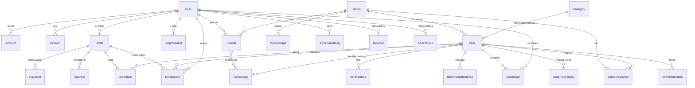

# Data Model

| Field | Isi |
| --- | --- |
| Database | PostgreSQL 16 |
| ORM | Prisma |
| Konvensi | `camelCase` di Prisma, `snake_case` di tabel (via `@@map`), semua nominal `Int` rupiah |
| Status | Draft — mengikuti requirement di [`02-requirements.md`](02-requirements.md) |

---

## 1. ERD



---

## 2. Skema Prisma

```prisma
generator client {
  provider = "prisma-client-js"
}

datasource db {
  provider = "postgresql"
  url      = env("DATABASE_URL")
}

// ─────────────────────────── Enums ───────────────────────────

enum Role {
  USER
  ADMIN
  SUPERADMIN
}

enum UserStatus {
  ACTIVE
  SUSPENDED
  DELETED
}

enum ItemType {
  FREE
  PREMIUM
}

enum ContentStatus {
  DRAFT
  IN_REVIEW
  PUBLISHED
  ARCHIVED
}

enum OrderStatus {
  PENDING
  PAID
  FULFILLED
  EXPIRED
  FAILED
  REFUNDED
}

enum OrderItemKind {
  ITEM          // pembelian item premium
  NO_ADS        // pembelian "tanpa iklan" untuk item gratis
}

enum PaymentStatus {
  PENDING
  PAID
  FAILED
  EXPIRED
  REFUNDED
}

enum SponsorStatus {
  PENDING_REVIEW
  ACTIVE
  EXPIRED
  REJECTED
}

enum SponsorBoard {
  UMUM
  WEBSITE_PRODUK
  DEVELOPER_TOOLS
  DESAIN_KREATIF
  AI_OTOMATISASI
  MARKETING_SEO
  KREATOR_KONTEN
  SOSIAL_MEDIA
  BISNIS_JASA
  GAME_HIBURAN
  ECOMMERCE_TOKO
  EDUKASI_BELAJAR
}

enum RequestStatus {
  NEW
  REVIEWING
  PLANNED
  PUBLISHED
  REJECTED
}

enum GrantSource {
  PURCHASE
  ADMIN_GIFT
  MIGRATION
}

enum DownloadPurpose {
  FREE_AD
  PREMIUM
}

enum DownloadResult {
  GRANTED
  DENIED_NO_ENTITLEMENT
  DENIED_RATE_LIMIT
  DENIED_SUSPENDED
  DENIED_EXPIRED_TOKEN
  ERROR
}

// ─────────────────────── Identitas & sesi ────────────────────

model User {
  id              String     @id @default(cuid())
  email           String     @unique
  emailVerified   DateTime?
  name            String?
  image           String?
  passwordHash    String?    // hanya akun lama
  role            Role       @default(USER)
  permissions     String[]   @default([]) // kapabilitas eksplisit untuk ADMIN
  status          UserStatus @default(ACTIVE)
  mfaEnabled      Boolean    @default(false)
  mfaSecretEnc    String?    // terenkripsi AES-GCM dengan kunci env
  mfaRecoveryEnc  String[]   @default([])
  lastLoginAt     DateTime?
  createdAt       DateTime   @default(now())
  updatedAt       DateTime   @updatedAt

  accounts     Account[]
  sessions     Session[]
  orders       Order[]
  entitlements Entitlement[]
  downloadTokens DownloadToken[]
  downloads    Download[]
  requests     AppRequest[]
  tutorials    Tutorial[]
  auditLogs    AdminAuditLog[]
  revisions    Revision[]
  invitesSent  AdminInvite[]  @relation("InviteSender")

  @@map("users")
}

model Account {
  id                String  @id @default(cuid())
  userId            String
  type              String
  provider          String
  providerAccountId String
  refresh_token     String? @db.Text
  access_token      String? @db.Text
  expires_at        Int?
  token_type        String?
  scope             String?
  id_token          String? @db.Text
  session_state     String?

  user User @relation(fields: [userId], references: [id], onDelete: Cascade)

  @@unique([provider, providerAccountId])
  @@map("accounts")
}

model Session {
  id           String   @id @default(cuid())
  sessionToken String   @unique
  userId       String
  expires      DateTime
  ipHash       String?
  userAgent    String?
  createdAt    DateTime @default(now())

  user User @relation(fields: [userId], references: [id], onDelete: Cascade)

  @@index([userId])
  @@map("sessions")
}

model VerificationToken {
  identifier String
  token      String   @unique
  expires    DateTime

  @@unique([identifier, token])
  @@map("verification_tokens")
}

model AdminInvite {
  id          String   @id @default(cuid())
  email       String
  role        Role     @default(ADMIN)
  permissions String[] @default([])
  tokenHash   String   @unique
  expiresAt   DateTime
  acceptedAt  DateTime?
  invitedById String
  createdAt   DateTime @default(now())

  invitedBy User @relation("InviteSender", fields: [invitedById], references: [id])

  @@index([email])
  @@map("admin_invites")
}

// ─────────────────────────── Katalog ─────────────────────────

model Category {
  id       String   @id @default(cuid())
  name     String
  slug     String   @unique
  order    Int      @default(0)
  isActive Boolean  @default(true)
  createdAt DateTime @default(now())
  updatedAt DateTime @updatedAt

  items Item[]

  @@index([isActive, order])
  @@map("categories")
}

model Technology {
  id        String   @id @default(cuid())
  name      String
  slug      String   @unique
  createdAt DateTime @default(now())

  items     ItemTechnology[]
  tutorials TutorialTag[]

  @@map("technologies")
}

model Item {
  id               String        @id @default(cuid())
  slug             String        @unique
  title            String
  type             ItemType
  status           ContentStatus @default(DRAFT)

  shortDescription String        @db.VarChar(200)
  description      String        @db.Text
  howItWorks       String?       @db.Text
  license          String?
  demoUrl          String?

  priceIdr         Int?          // wajib bila PREMIUM
  noAdsPriceIdr    Int?          // wajib bila FREE

  releasedAt       DateTime?
  publishedAt      DateTime?
  featured         Boolean       @default(false)

  driveFileId      String?
  driveFileSize    BigInt?
  driveVerifiedAt  DateTime?

  downloadCount    Int           @default(0) // denormalisasi, sumber: Download GRANTED
  categoryId       String?
  thumbnailMediaId String?

  seoTitle         String?       @db.VarChar(70)
  seoDescription   String?       @db.VarChar(160)

  createdAt        DateTime      @default(now())
  updatedAt        DateTime      @updatedAt
  deletedAt        DateTime?     // soft delete

  category     Category?            @relation(fields: [categoryId], references: [id])
  thumbnail    Media?               @relation("ItemThumbnail", fields: [thumbnailMediaId], references: [id])
  technologies ItemTechnology[]
  features     ItemFeature[]
  steps        ItemInstallationStep[]
  screenshots  ItemScreenshot[]
  priceHistory ItemPriceHistory[]
  orderItems   OrderItem[]
  entitlements Entitlement[]
  tokens       DownloadToken[]
  downloads    Download[]

  @@index([status, type, publishedAt(sort: Desc)])
  @@index([status, categoryId, publishedAt(sort: Desc)])
  @@index([status, downloadCount(sort: Desc)])
  @@map("items")
}

model ItemTechnology {
  itemId       String
  technologyId String

  item       Item       @relation(fields: [itemId], references: [id], onDelete: Cascade)
  technology Technology @relation(fields: [technologyId], references: [id], onDelete: Cascade)

  @@id([itemId, technologyId])
  @@index([technologyId])
  @@map("item_technologies")
}

model ItemFeature {
  id     String @id @default(cuid())
  itemId String
  order  Int
  text   String @db.VarChar(160)

  item Item @relation(fields: [itemId], references: [id], onDelete: Cascade)

  @@unique([itemId, order])
  @@map("item_features")
}

model ItemInstallationStep {
  id     String @id @default(cuid())
  itemId String
  order  Int
  title  String @db.VarChar(120)
  body   String @db.Text

  item Item @relation(fields: [itemId], references: [id], onDelete: Cascade)

  @@unique([itemId, order])
  @@map("item_installation_steps")
}

model ItemScreenshot {
  id      String @id @default(cuid())
  itemId  String
  mediaId String
  order   Int
  caption String? @db.VarChar(160)

  item  Item  @relation(fields: [itemId], references: [id], onDelete: Cascade)
  media Media @relation(fields: [mediaId], references: [id])

  @@unique([itemId, order])
  @@map("item_screenshots")
}

model ItemPriceHistory {
  id          String   @id @default(cuid())
  itemId      String
  priceIdr    Int?
  noAdsPriceIdr Int?
  changedById String
  reason      String?  @db.VarChar(200)
  createdAt   DateTime @default(now())

  item Item @relation(fields: [itemId], references: [id], onDelete: Cascade)

  @@index([itemId, createdAt(sort: Desc)])
  @@map("item_price_history")
}

// ─────────────────────────── Media ───────────────────────────

model Media {
  id         String   @id @default(cuid())
  key        String   @unique  // R2 object key
  alt        String   @db.VarChar(200)
  width      Int
  height     Int
  bytes      Int
  mime       String
  checksum   String   @unique  // sha256, untuk dedup
  createdById String?
  createdAt  DateTime @default(now())

  itemThumbnails Item[]           @relation("ItemThumbnail")
  screenshots    ItemScreenshot[]
  tutorials      Tutorial[]
  usages         MediaUsage[]

  @@map("media")
}

model MediaUsage {
  id         String @id @default(cuid())
  mediaId    String
  entityType String @db.VarChar(30)
  entityId   String
  field      String @db.VarChar(40)

  media Media @relation(fields: [mediaId], references: [id], onDelete: Cascade)

  @@unique([mediaId, entityType, entityId, field])
  @@index([entityType, entityId])
  @@map("media_usages")
}

// ─────────────────────────── Tutorial ────────────────────────

model Tutorial {
  id          String        @id @default(cuid())
  slug        String        @unique
  title       String        @db.VarChar(140)
  excerpt     String        @db.VarChar(240)
  content     String        @db.Text // MDX
  heroMediaId String?
  readMinutes Int           @default(5)
  status      ContentStatus @default(DRAFT)
  authorId    String
  publishedAt DateTime?
  createdAt   DateTime      @default(now())
  updatedAt   DateTime      @updatedAt
  deletedAt   DateTime?

  hero   Media?         @relation(fields: [heroMediaId], references: [id])
  author User           @relation(fields: [authorId], references: [id])
  tags   TutorialTag[]

  @@index([status, publishedAt(sort: Desc)])
  @@map("tutorials")
}

model TutorialTag {
  tutorialId   String
  technologyId String

  tutorial   Tutorial   @relation(fields: [tutorialId], references: [id], onDelete: Cascade)
  technology Technology @relation(fields: [technologyId], references: [id], onDelete: Cascade)

  @@id([tutorialId, technologyId])
  @@map("tutorial_tags")
}

// ───────────────────── Sponsor & request ─────────────────────

model Sponsor {
  id             String        @id @default(cuid())
  link           String
  amountIdr      Int
  board          SponsorBoard  @default(UMUM)
  description    String?       @db.VarChar(140)
  status         SponsorStatus @default(PENDING_REVIEW)
  orderId        String?
  startsAt       DateTime?
  endsAt         DateTime?
  moderatedById  String?
  moderatedAt    DateTime?
  rejectReason   String?       @db.VarChar(200)
  createdAt      DateTime      @default(now())

  order Order? @relation(fields: [orderId], references: [id])

  @@index([status, board, amountIdr(sort: Desc)])
  @@map("sponsors")
}

model AppRequest {
  id          String        @id @default(cuid())
  name        String        @db.VarChar(80)
  email       String
  appTitle    String        @db.VarChar(120)
  technology  String?       @db.VarChar(60)
  status      RequestStatus @default(NEW)
  internalNote String?      @db.Text
  publicNote  String?       @db.Text
  userId      String?
  tokenHash   String        @unique // untuk melihat status tanpa login
  createdAt   DateTime      @default(now())
  updatedAt   DateTime      @updatedAt

  user User? @relation(fields: [userId], references: [id])

  @@index([status, createdAt(sort: Desc)])
  @@index([email])
  @@map("app_requests")
}

// ─────────────────────── Pesanan & akses ─────────────────────

model Order {
  id            String      @id @default(cuid())
  orderNo       String      @unique          // mis. RT-20261028-8F3K2A
  userId        String?
  guestEmail    String?
  status        OrderStatus @default(PENDING)

  subtotalIdr   Int
  serviceFeeIdr Int
  totalIdr      Int

  providerRef   String?     @unique          // invoice number DOKU
  idempotencyKey String?    @unique
  expiresAt     DateTime
  paidAt        DateTime?
  fulfilledAt   DateTime?
  refundedAt    DateTime?
  refundReason  String?     @db.VarChar(300)
  ipHash        String?
  createdAt     DateTime    @default(now())
  updatedAt     DateTime    @updatedAt

  user         User?         @relation(fields: [userId], references: [id])
  items        OrderItem[]
  payments     Payment[]
  entitlements Entitlement[]
  sponsors     Sponsor[]

  @@index([status, createdAt(sort: Desc)])
  @@index([userId, createdAt(sort: Desc)])
  @@index([guestEmail])
  @@map("orders")
}

model OrderItem {
  id            String        @id @default(cuid())
  orderId       String
  itemId        String
  kind          OrderItemKind @default(ITEM)
  titleSnapshot String        @db.VarChar(140)
  priceIdr      Int
  quantity      Int           @default(1)

  order Order @relation(fields: [orderId], references: [id], onDelete: Cascade)
  item  Item  @relation(fields: [itemId], references: [id])

  @@unique([orderId, itemId, kind])
  @@map("order_items")
}

model Payment {
  id          String        @id @default(cuid())
  orderId     String
  provider    String        @default("DOKU")
  providerRef String        @unique
  amountIdr   Int
  status      PaymentStatus @default(PENDING)
  method      String?       @db.VarChar(40) // QRIS, VA_BCA, ...
  paidAt      DateTime?
  createdAt   DateTime      @default(now())

  order Order @relation(fields: [orderId], references: [id], onDelete: Cascade)

  @@index([orderId])
  @@map("payments")
}

model PaymentEvent {
  id            String   @id @default(cuid())
  provider      String   @default("DOKU")
  eventId       String   @unique   // idempotency webhook
  orderId       String?
  signatureValid Boolean @default(false)
  payload       Json
  processedAt   DateTime?
  error         String?
  createdAt     DateTime @default(now())

  @@index([orderId])
  @@map("payment_events")
}

model Entitlement {
  id           String      @id @default(cuid())
  userId       String
  itemId       String
  orderId      String?
  source       GrantSource @default(PURCHASE)
  grantedAt    DateTime    @default(now())
  revokedAt    DateTime?
  revokedById  String?
  revokeReason String?     @db.VarChar(200)

  user  User   @relation(fields: [userId], references: [id], onDelete: Cascade)
  item  Item   @relation(fields: [itemId], references: [id])
  order Order? @relation(fields: [orderId], references: [id])

  @@index([userId, itemId]) // INV-06 ditegakkan partial unique, lihat §2.1
  @@index([itemId])
  @@map("entitlements")
}

model DownloadToken {
  id            String          @id @default(cuid())
  tokenHash     String          @unique
  itemId        String
  userId        String?
  downloadSessionId String?     // cookie anonim (hash)
  purpose       DownloadPurpose
  expiresAt     DateTime
  maxUses       Int             @default(1)
  uses          Int             @default(0)
  usedAt        DateTime?
  ipHash        String?
  createdAt     DateTime        @default(now())

  item Item  @relation(fields: [itemId], references: [id], onDelete: Cascade)
  user User? @relation(fields: [userId], references: [id])

  @@index([itemId, createdAt(sort: Desc)])
  @@index([userId, itemId])
  @@map("download_tokens")
}

model Download {
  id            String          @id @default(cuid())
  itemId        String
  userId        String?
  tokenId       String?
  purpose       DownloadPurpose
  result        DownloadResult
  bytesSent     BigInt?
  ipHash        String?
  uaHash        String?
  referrer      String?         @db.VarChar(200)
  createdAt     DateTime        @default(now())

  item Item  @relation(fields: [itemId], references: [id])
  user User? @relation(fields: [userId], references: [id])

  @@index([itemId, createdAt(sort: Desc)])
  @@index([userId, createdAt(sort: Desc)])
  @@index([result, createdAt])
  @@map("downloads")
}

// ─────────────────── Audit, revisi, pengaturan ───────────────

model AdminAuditLog {
  id         String   @id @default(cuid())
  actorId    String?
  actorEmail String
  action     String   @db.VarChar(60)
  entityType String   @db.VarChar(30)
  entityId   String
  before     Json?
  after      Json?
  ip         String?
  userAgent  String?  @db.VarChar(300)
  requestId  String?
  createdAt  DateTime @default(now())

  actor User? @relation(fields: [actorId], references: [id])

  @@index([entityType, entityId, createdAt(sort: Desc)])
  @@index([actorId, createdAt(sort: Desc)])
  @@index([createdAt])
  @@map("admin_audit_logs")
}

model Revision {
  id          String   @id @default(cuid())
  entityType  String   @db.VarChar(30)
  entityId    String
  version     Int
  snapshot    Json
  createdById String
  createdAt   DateTime @default(now())

  createdBy User @relation(fields: [createdById], references: [id])

  @@unique([entityType, entityId, version])
  @@map("revisions")
}

model Setting {
  key         String   @id
  value       Json
  updatedById String?
  updatedAt   DateTime @updatedAt

  @@map("settings")
}

model Redirect {
  id        String   @id @default(cuid())
  fromPath  String   @unique
  toPath    String
  status    Int      @default(308)
  createdAt DateTime @default(now())

  @@map("redirects")
}

model EmailLog {
  id        String   @id @default(cuid())
  to        String
  template  String   @db.VarChar(60)
  subject   String   @db.VarChar(200)
  status    String   @db.VarChar(20) // QUEUED, SENT, FAILED
  error     String?
  createdAt DateTime @default(now())

  @@index([to, createdAt(sort: Desc)])
  @@map("email_logs")
}
```

---

### 2.1 Berkas migrasi dan perkakas

| Berkas | Isi |
| --- | --- |
| `prisma/schema.prisma` | Transkripsi §2 apa adanya |
| `prisma/migrations/20261028000000_init/` | DDL hasil `prisma migrate diff --from-empty`, dihasilkan tanpa perlu database |
| `prisma/migrations/20261028000100_invariants/` | Ditulis tangan: `pg_trgm`, CHECK INV-01/02/03/04/11, partial unique INV-06, CHECK INV-07, indeks GIN pencarian, dan `REVOKE` INV-10 |
| `prisma.config.ts` | Menunjuk skema + perintah seed; memuat `.env` lewat `process.loadEnvFile()` |
| `prisma/seed.ts` | Seed idempoten §5, dijalankan `npm run db:seed` (tsx) |
| `prisma/checks/invariants.sql` | Uji regresi INV-01..07 + indeks pencarian; transaksi di-`ROLLBACK` sehingga database tidak berubah |

Catatan:

- **`@@unique([userId, itemId])` tidak dipakai.** Unique penuh akan menolak grant ulang setelah refund/cabut, sedangkan INV-06 hanya melarang **dua entitlement aktif**. Prisma belum bisa menyatakan partial index, jadi yang ada di skema hanya `@@index`, dan `entitlements_active_unique ... WHERE "revokedAt" IS NULL` dibuat di migrasi `invariants`.
- **Prisma dipin ke 6.19.3.** Prisma 7/8 memindahkan generator ke `prisma-client` dan mewajibkan driver adapter; migrasi ke sana dilakukan sebagai pekerjaan tersendiri, bukan diam-diam saat M0.
- Migrasi `invariants` memakai blok `DO $$ ... $$` untuk `REVOKE` agar tidak gagal di lokal yang tidak punya role `app_role`.
- Indeks pencarian memakai `to_tsvector('indonesian', ...)` (konfigurasi konstan ⇒ immutable) dan `gin_trgm_ops`; keduanya hanya bisa dibuat lewat SQL, bukan `schema.prisma`.

### 2.2 Kunci pengaturan dan aset merek

`Setting` menyimpan **satu nilai JSON skalar per baris**, dengan `key` ber-namespace titik. Pembaca di aplikasi selalu memberi nilai cadangan (`getSetting(key, fallback)`) dan mengabaikan nilai yang tipenya tidak cocok, sehingga satu kunci hilang atau rusak tidak pernah menggagalkan render.

| Grup | Kunci | Tipe | Seed/default | Dibaca oleh |
| --- | --- | --- | --- | --- |
| Identitas situs | `site.name`, `site.tagline`, `site.whatsapp` | string | `Reditech`, tagline, placeholder nomor | Header, footer, JSON-LD, halaman kontak |
| **Merek** | `brand.logoLightMediaId`, `brand.logoDarkMediaId`, `brand.wordmarkMediaId`, `brand.faviconMediaId`, `brand.icon192MediaId`, `brand.icon512MediaId`, `brand.iconMaskableMediaId`, `brand.ogFallbackMediaId` | `Media.id` | **tidak di-seed** → fallback statis bertanda "default" | Header/footer, `metadata.icons`, `manifest.webmanifest`, OG fallback |
| **Aset landing** | `landing.heroMediaId`, `landing.assets` | `Media.id`; array `{ mediaId, slot, alt, href? }` | tidak di-seed | Beranda; slot dikenal: `hero`, `fitur`, `cta`, `og-landing` |
| Harga | `pricing.noAdsPriceIdr`, `pricing.serviceFeeIdr` | number (IDR) | `3000`, `21` | Panel unduhan, checkout |
| Iklan | `ads.enabled`, `ads.interstitialSeconds` | boolean, number | `true` (implisit), `10` | Proxy + `/api/download/[slug]/token`, S04 |
| Keamanan | `security.downloadDailyLimit` | number | `5` | Kuota unduhan (FR-DL-06) |
| Pembayaran | `payment.expiryMinutes` | number | `1440` | Checkout DOKU (M5) |
| Email/SEO | `email.*`, `seo.*` | string/boolean | — | Email transaksional, metadata (M3/M6) |

Aturan:

- **Nilai aset adalah `mediaId`, bukan URL.** URL dirakit `mediaUrl()` saat render, jadi mengganti berkas dengan nama sama tidak mengubah kunci pengaturan dan tidak meninggalkan URL mati di database.
- Setiap kunci `brand.*`/`landing.*` yang terisi **wajib** punya baris `MediaUsage` (`entityType='setting'`, `entityId=<key>`, `field=<slot>`). INV-13 memakai baris itu untuk menolak penghapusan media yang masih dirujuk.
- Kunci `brand.*`/`landing.*` yang kosong **bukan** berarti "tidak ada logo": UI memakai fallback statis dan panel menandainya **default**, agar admin tahu aset belum diunggah.
- Nilai default tidak ditulis ke database saat seed. Baris hanya dibuat ketika admin menyimpan tab terkait, sehingga `undefined` (belum diatur) tetap bisa dibedakan dari nilai yang sengaja disetel sama dengan default.
- Menyimpan pengaturan memanggil `revalidateTag("settings")`; tab Identitas/Aset landing juga memanggil `revalidateTag("brand")` karena `manifest.webmanifest` dan metadata ikon memakai cache tag itu.

---

## 3. Invariant data (wajib ditegakkan di server + constraint DB)

| ID | Invariant | Penegakan |
| --- | --- | --- |
| INV-01 | `type=FREE` ⇒ `priceIdr IS NULL` dan `noAdsPriceIdr > 0` | CHECK constraint |
| INV-02 | `type=PREMIUM` ⇒ `priceIdr > 0` dan `noAdsPriceIdr IS NULL` | CHECK constraint |
| INV-03 | `status=PUBLISHED` ⇒ `publishedAt IS NOT NULL` | CHECK constraint |
| INV-04 | `order.totalIdr = subtotalIdr + serviceFeeIdr` | CHECK + hitung server |
| INV-05 | `order.totalIdr = SUM(orderItem.priceIdr × quantity)` + fee | Trigger/validasi aplikasi |
| INV-06 | Satu `Entitlement` aktif per (`userId`,`itemId`) | UNIQUE parsial: `WHERE revokedAt IS NULL` (tidak bisa di `schema.prisma`; lihat §2.1) |
| INV-07 | Token unduhan sekali pakai (`uses <= maxUses`) | Update bersyarat atomik |
| INV-08 | `DownloadToken` mati bila entitlement dicabut | Pemeriksaan saat penukaran token |
| INV-09 | Slug item tidak berubah setelah `PUBLISHED` | Aplikasi + baris `Redirect` |
| INV-10 | `AdminAuditLog` tidak dapat diubah/dihapus | `REVOKE UPDATE, DELETE` dari role aplikasi |
| INV-11 | Nominal tidak pernah negatif atau nol pada order final | CHECK `totalIdr >= 0` + validasi |
| INV-12 | Order `FULFILLED` tidak dapat kembali ke `PENDING` | State machine aplikasi + trigger guard |
| INV-13 | Media terpakai tidak dapat dihapus | Cek `MediaUsage` dalam transaksi |

Contoh DDL pelengkap (dijalankan sebagai migrasi SQL manual di samping Prisma):

```sql
ALTER TABLE items
  ADD CONSTRAINT items_price_by_type CHECK (
    (type = 'FREE'    AND "priceIdr" IS NULL AND "noAdsPriceIdr" > 0) OR
    (type = 'PREMIUM' AND "priceIdr" > 0    AND "noAdsPriceIdr" IS NULL)
  );

ALTER TABLE items
  ADD CONSTRAINT items_published_at CHECK (
    status <> 'PUBLISHED' OR "publishedAt" IS NOT NULL
  );

ALTER TABLE orders
  ADD CONSTRAINT orders_total_match CHECK ("totalIdr" = "subtotalIdr" + "serviceFeeIdr");

CREATE UNIQUE INDEX entitlements_active_unique
  ON entitlements ("userId", "itemId")
  WHERE "revokedAt" IS NULL;

REVOKE UPDATE, DELETE ON admin_audit_logs FROM app_role;
```

**Status verifikasi (M0).** Kedua migrasi diterapkan ke PostgreSQL 16.12 kosong (`prisma migrate deploy`), seed dijalankan dua kali tanpa duplikasi, dan `prisma/checks/invariants.sql` membuktikan: INV-01, INV-02, INV-03, INV-04, INV-11, INV-06 (aktif ganda), serta INV-07 menolak pelanggaran; grant ulang setelah `revokedAt` diisi tetap diterima; `pg_trgm`, `items_search_tsv_idx`, dan `items_title_trgm_idx` aktif (`websearch_to_tsquery('indonesian','kasir')` menemukan 1 item).

---

## 4. Strategi indeks dan query

| Query | Indeks |
| --- | --- |
| Katalog default (publish, urut `publishedAt` desc) | `(status, type, publishedAt DESC)` |
| Filter kategori | `(status, categoryId, publishedAt DESC)` |
| Urut terpopuler | `(status, downloadCount DESC)` |
| Pencarian teks | `GIN (to_tsvector('indonesian', title \|\| ' ' \|\| shortDescription))` |
| Pencarian samar | `GIN (title gin_trgm_ops)` |
| Riwayat unduhan pengguna | `(userId, createdAt DESC)` |
| Audit per entitas | `(entityType, entityId, createdAt DESC)` |

Pencarian memakai satu parameter `search` di server yang menggabungkan dua predikat:

1. `to_tsvector('indonesian', title || ' ' || shortDescription) @@ websearch_to_tsquery('indonesian', search)` — bentuk kata.
2. `word_similarity(search, title) > 0.5` — toleransi salah ketik ringan (FR-CAT-14).

Hasil diurutkan: `ts_rank` → `word_similarity` → `publishedAt DESC` → `id ASC`.

Ambang `word_similarity` dipilih **0.5**, bukan `similarity() > 0.3`: `similarity()` membandingkan seluruh judul sehingga judul panjang seperti "Aplikasi POS Kasir Laravel" hanya mendapat 0.185 untuk "kasirr" dan tidak lolos. `word_similarity` mencari kecocokan pada potongan terbaik dan memberi 0.714 untuk pasangan yang sama. Diuji pada data seed: `kasir`, `kasirr`, `undngan`, `gudang` semuanya menemukan item yang benar; `zzz` mengembalikan 0 hasil.

Setiap urutan diakhiri `i."id" ASC` sebagai pemecah seri, agar dua item bertanggal sama tidak bertukar posisi antar-permintaan (FR-CAT-06 deterministik).

---

## 5. Seed data minimum

| Entitas | Isi |
| --- | --- |
| `User` | 1 SUPERADMIN (email pemilik), MFA belum aktif |
| `Category` | 10 kategori sesuai paritas: CodeIgniter, GAS, Java, Laravel, Mobile App, Native PHP, Next.js, PHP, Python, WordPress. "Semua" bukan baris, melainkan state UI |
| `Technology` | PHP, Laravel, Next.js, Python, Java, WordPress, GAS, CodeIgniter, React Native, Flutter |
| `Setting` | 5 baris skalar: `pricing.noAdsPriceIdr=3000`, `pricing.serviceFeeIdr=21`, `ads.interstitialSeconds=10`, `security.downloadDailyLimit=5`, `payment.expiryMinutes=1440`. Kunci `brand.*`/`landing.*` sengaja tidak di-seed (§2.2) |
| `Item` | 3 contoh (1 gratis, 1 premium murah, 1 premium mahal) untuk uji alur, masing-masing `publishedAt`/`releasedAt` sendiri agar urutan `newest`/`oldest` berbeda |
| `Media` | 6 aset demo (`public/seed/*.svg`, 1200×760) — 2 screenshot per item |
| `ItemScreenshot` | 2 per item, `order` 1..2; `items.thumbnailMediaId` menunjuk screenshot pertama |
| `Tutorial` | 2 artikel contoh |

Seed bersifat idempoten (`upsert` by slug/email) agar aman dijalankan berulang di staging. Media demo memakai key berawalan `/` yang berarti "aset di `public/`"; key R2 tidak pernah diawali garis miring, sehingga `mediaUrl()` bisa membedakan keduanya tanpa konfigurasi tambahan. `bytes` dan `checksum` dihitung dari berkas nyata saat seed berjalan.

Berkas unduhan contoh dibuat `prisma/seed-storage.ts` tanpa dependensi ZIP tambahan dan ditulis ke storage sesuai `STORAGE_DRIVER`: `local` → `<LOCAL_STORAGE_DIR>/seed/<slug>.zip`, `drive` → provider. `items.driveFileId` menyimpan **kunci penyimpanan** (bukan hanya ID Drive — lihat `00-tech-stack.md` ADR-010), dan seed **tidak menimpa** kunci yang sudah bukan `seed/…` agar unggahan asli tidak tertimpa saat seed diulang.

---

## 6. Retensi dan pembersihan

| Data | Retensi | Mekanisme |
| --- | --- | --- |
| `DownloadToken` kedaluwarsa | 7 hari | Cron harian |
| `Download` | 24 bulan | Arsip ke R2 lalu hapus |
| `PaymentEvent` | 24 bulan | Arsitektur ke R2 (NDJSON) |
| `AdminAuditLog` | 24 bulan | Arsip ke R2, tetap dapat dicari lewat indeks arsip |
| Konten `ARCHIVED` | 30 hari | Purge permanen oleh cron, dengan laporan |
| `EmailLog` | 6 bulan | Hapus |
| Akun `DELETED` | Anonimisasi langsung, baris tetap | Email diganti `deleted+<id>@invalid` |

---

## 7. Catatan migrasi dari sistem lama

Bila data dari situs acuan akan dipindahkan:

1. Petakan item lama ke `Item` dengan `status=PUBLISHED`, `publishedAt` dari tanggal rilis.
2. Unduhan lama (`downloadCount`) diisi sebagai angka awal, lalu ditandai `source=MIGRATION` pada catatan terpisah — jangan membuat 1.175 baris `Download` palsu.
3. Pembeli lama → `Entitlement` dengan `source=MIGRATION` dan `orderId=NULL`, agar tidak mengarang invoice.
4. Akun tanpa `passwordHash` (akun Google) tetap dapat login lewat OAuth; akun lama dipertahankan `passwordHash`-nya sampai pengguna mengganti.
5. Slug dipertahankan apa adanya; jangan normalisasi ulang, atau tautan lama akan mati.
