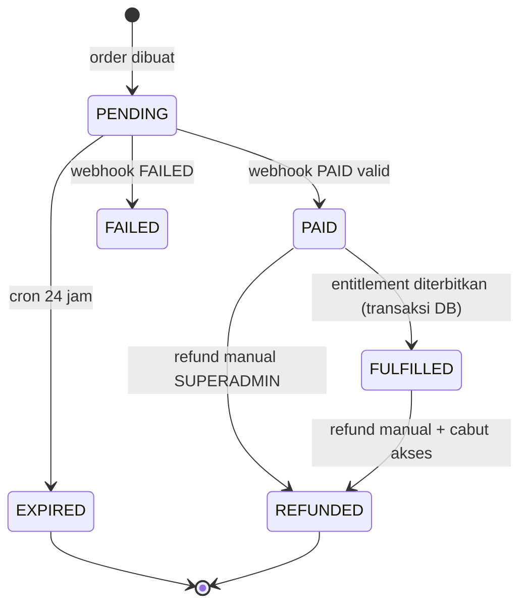

# API & Kontrak Server

| Field | Isi |
| --- | --- |
| Basis | Next.js Route Handlers (`/api/*`) + Server Actions untuk mutasi UI |
| Format | JSON `application/json; charset=utf-8` |
| Autentikasi | Cookie sesi (Auth.js); tidak ada bearer token publik di v1.0 |
| Kontrak data | Zod di [`02-requirements.md`](02-requirements.md) + [`03-data-model.md`](03-data-model.md) |

---

## 1. Konvensi umum

### 1.1 Amplop respons

```json
// sukses
{ "data": { "...": "..." } }

// gagal
{ "error": { "code": "DOWNLOAD_RATE_LIMITED", "message": "Batas unduhan tercapai.", "details": { "retryAfterSeconds": 3600 }, "requestId": "req_01H..." } }
```

Aturan: `code` stabil dan dapat dipakai klien; `message` berbahasa Indonesia dan boleh berubah; `details` opsional; `requestId` selalu ada (juga di header `X-Request-Id`).

### 1.2 Kode error

| HTTP | `code` | Kapan |
| --- | --- | --- |
| 400 | `VALIDATION_FAILED` | Zod gagal; `details.fields` berisi peta field → pesan |
| 401 | `UNAUTHENTICATED` | Tidak ada sesi pada endpoint yang butuh |
| 403 | `FORBIDDEN` | Sesi ada, kapabilitas kurang |
| 403 | `NO_ENTITLEMENT` | Unduhan premium tanpa akses |
| 403 | `AD_GATE_REQUIRED` | Interstisial iklan belum dimuat; cookie `dl_gate` tidak ada/kedaluwarsa |
| 404 | `NOT_FOUND` | Item/order tidak ada |
| 409 | `CONFLICT` | Slug duplikat, konflik versi (`updatedAt` berubah) |
| 410 | `GONE` | Item `ARCHIVED`, token kedaluwarsa/terpakai |
| 422 | `UNPROCESSABLE` | Melanggar invariant (mis. harga tipe salah) |
| 429 | `RATE_LIMITED` | Batas terlampaui; `Retry-After` disertakan |
| 500 | `INTERNAL` | Tidak terduga; log dengan `requestId` |
| 503 | `DEPENDENCY_UNAVAILABLE` | Drive/DOKU/Redis tidak tersedia |

### 1.3 Header wajib

| Header | Nilai |
| --- | --- |
| `Cache-Control` | `private, no-store` untuk semua `/api/*`; `/admin/*`, `/dashboard/*`, `/download/*` memakai `private, no-cache, no-store, max-age=0, must-revalidate` |
| `X-Content-Type-Options` | `nosniff` |
| `X-Request-Id` | UUID per request; nilai yang sama masuk amplop error |
| `Content-Security-Policy` | satu kebijakan untuk semua rute: `script-src 'self' 'unsafe-inline'` (`'unsafe-eval'` hanya di dev), tanpa nonce |
| `X-Robots-Tag` | `noindex, nofollow` untuk `/api/*`, `/admin/*`, `/dashboard/*`, `/download/*` |
| `Retry-After` | wajib pada `429`; detik, sama dengan `details.retryAfterSeconds` |

### 1.4 Rate limit (Redis, sliding window)

| Endpoint | Batas |
| --- | --- |
| `GET /api/download/*` | 10/menit per IP + 20/menit per sesi |
| `POST /api/download/*/token` | 10/menit per IP |
| `POST /api/orders` | 5/menit per IP, 20/jam per email |
| `POST /api/webhooks/doku` | Tanpa batas; wajib signature valid |
| Login/OAuth callback | 10/menit per IP |
| Server action admin (tulis) | 60/menit per aktor |

Catatan implementasi: Redis **opsional**. Bila `REDIS_URL` kosong, penghitung sliding window jatuh ke memori per proses dan `/api/health` melaporkan `redis: "not_configured"` (bukan `down`). Kuota unduhan **tidak** memakai Redis — sumber kebenarannya tabel `downloads` (lihat §3.2).

---

## 2. Rute halaman (bukan API)

Dirender server (RSC). Tidak ada endpoint JSON katalog — konsisten dengan arsitektur asli (ADR-004).

| Rute | Tipe | Cache |
| --- | --- | --- |
| `/` | RSC/static shell + data | `no-store` HTML, aset `immutable` |
| `/source-code` + query | RSC dinamis | `no-store` |
| `/source-code/[slug]` | RSC + ISR 5 menit | `no-store` untuk pengguna login |
| `/download/[slug]/ads` | RSC + klien countdown | `no-store`, `noindex` |
| `/download/[slug]/expired` | RSC, halaman 410 | `no-store`, `noindex` |
| `/tutorial`, `/tutorial/[slug]` | RSC + ISR 10 menit | `no-store` |
| `/dashboard/*` | RSC, wajib sesi | `no-store` |
| `/admin/*` | RSC, wajib kapabilitas | `no-store`, `noindex` |

---

## 3. Endpoint unduhan

### 3.1 `GET /api/download/[slug]`

Titik masuk yang dipakai tombol (paritas URL dengan situs asli). Server menentukan tujuan; browser tidak pernah menerima tautan penyimpanan.

| Kondisi | Respons |
| --- | --- |
| Item `FREE` | `302` → `/download/[slug]/ads` |
| Item `PREMIUM`, punya entitlement | Terbitkan token → `303` → `/api/download/file/[token]` |
| Item `PREMIUM`, tanpa entitlement | `303` → `/source-code/[slug]?beli=1` |
| Item `ARCHIVED` | `410` → halaman `GONE` (HTML, bukan JSON) |
| Slug tidak ada / `deletedAt` terisi | `404` → halaman `404` |
| `driveFileId` kosong | `503` teks biasa |

Tidak ada `Location` ke domain pihak ketiga. Tidak ada `Referer` yang diteruskan ke luar.

Catatan implementasi:

- Halaman `404`/`410`/`403` diambil server-side dengan `fetch` internal ber-header `x-reditech-status-page: 1`, lalu dikirim ulang dengan status yang diminta. Route handler tidak bisa `rewrite` ke halaman, dan proxy mengabaikan permintaan yang membawa header itu agar tidak terjadi perulangan.
- Jalur premium **membuat `dl_session` sebelum token diterbitkan**, sehingga unduhan pertama ikut terhitung kuota. Bila cookie dibuat setelah token, `download_tokens.downloadSessionId` akan `null` untuk unduhan pertama (FR-DL-06 bocor satu unduhan).
- Slug pada path ini mengikuti aturan huruf kecil di proxy. **Path token dikecualikan** dari pengalihan huruf kecil karena nilainya base64url peka huruf besar-kecil (lihat §3.3).

### 3.2 `POST /api/download/[slug]/token`

Membuat token unduhan setelah gerbang iklan (atau untuk pengguna berhak).

**Prasyarat.** Cookie `dl_gate` (httpOnly, `SameSite=Lax`, `Secure` di produksi, umur 15 menit) berisi `v1.<slug>.<issuedAtMs>.<hmac-sha256>`; slug terikat ke tanda tangan sehingga cookie item A tidak berlaku untuk item B. **Cookie dipasang proxy** saat `GET /download/[slug]/ads` — Server Component tidak boleh menulis cookie, sehingga render pertama halaman belum melihat cookie itu dan hitung mundur dimulai dari durasi penuh; permintaan berikutnya menghitung sisa waktu dari `issuedAt`.

Hitung mundur adalah kontrol UX, bukan batas keamanan: endpoint hanya memverifikasi **keabsahan dan umur cookie**, bukan jumlah detik yang sudah berlalu. Konsekuensinya, pengguna yang membuka DevTools bisa mengirim `POST` sebelum hitung mundur selesai. Celah itu tidak menambah jumlah unduhan (kuota tetap ditegakkan), tidak melewati halaman iklan (cookie hanya terbit saat halaman dimuat), dan tidak memberi akses tanpa token bertanda tangan. Menegakkan detik di server akan menambah status yang harus disimpan dan memperumit perilaku muat ulang/tanpa JavaScript untuk manfaat yang kecil — jadi tidak dilakukan.

```http
POST /api/download/aplikasi-point-of-sales-pos-mtgs89ab/token
Content-Type: application/json

{ "purpose": "FREE_AD" }
```

```json
{ "data": { "url": "/api/download/file/dl_01HX…", "expiresAt": "2026-10-28T10:05:00Z", "filename": "reditech-pos.zip", "sizeBytes": 18324567 } }
```

**Dua bentuk permintaan.**

| Pemanggil | Body | Sukses | Gagal |
| --- | --- | --- | --- |
| `fetch` (JSON) | `application/json` | `201` + JSON di atas | JSON error + status |
| Form tanpa JavaScript | `application/x-www-form-urlencoded` | `303` → `/api/download/file/[token]` | `303` → `/download/[slug]/ads?error=<kode>&wait=<detik>` |

`purpose` boleh dihilangkan: item `FREE` dianggap `FREE_AD`, item `PREMIUM` dianggap `PREMIUM`. Nilai yang tidak dikenal diperlakukan sama. `FREE_AD` untuk item premium → `400 VALIDATION_FAILED`.

**Urutan pemeriksaan.** Tipe/purpose → rate limit burst (10/menit/IP, Redis atau memori) → hak akses (`PREMIUM`: entitlement aktif; `FREE_AD`: cookie gerbang, **dilewati bila `ads.enabled=false`**) → kuota 24 jam (`downloads` di PostgreSQL, bukan Redis) → terbitkan token.

| Kode | Kondisi |
| --- | --- |
| 201 | Token terbit |
| 303 | Bentuk form: token terbit, langsung dialihkan ke berkas |
| 400 `VALIDATION_FAILED` | `purpose=FREE_AD` untuk item premium |
| 403 `AD_GATE_REQUIRED` | Cookie `dl_gate` tidak ada/kedaluwarsa dan iklan aktif |
| 403 `NO_ENTITLEMENT` | `purpose=PREMIUM` tanpa entitlement (dicatat `DENIED_NO_ENTITLEMENT`) |
| 404 `NOT_FOUND` | Slug tidak ada |
| 410 `GONE` | Item `ARCHIVED` |
| 429 `RATE_LIMITED` | Burst atau kuota; `Retry-After` + `details.retryAfterSeconds` (kuota dicatat `DENIED_RATE_LIMIT`) |
| 503 `DEPENDENCY_UNAVAILABLE` | `driveFileId` kosong |

Token disimpan sebagai hash sha256, bukan nilai mentah; umur 5 menit; `maxUses=1`. Cookie `dl_session` (anonim, 1 tahun) dibuat **sebelum** token dan nilainya sama dengan yang dikirim ke klien, sehingga kuota anonim berlaku sejak unduhan pertama.

### 3.3 `GET /api/download/file/[token]`

Mengalirkan byte dari `StorageProvider`.

**Perilaku.**
1. Cari token by hash; `404` (halaman) bila tidak dikenal.
2. Item `deletedAt` → `404`; item `ARCHIVED` → `410` halaman `GONE`.
3. Tolak bila `uses >= maxUses` atau `expiresAt < now` → `410` halaman `/download/[slug]/expired` + `Download(DENIED_EXPIRED_TOKEN)`.
4. `purpose=PREMIUM`: entitlement dicabut → `403` + `Download(DENIED_NO_ENTITLEMENT)`.
5. **Klaim token secara atomik sebelum stream** (`UPDATE … WHERE uses < 1`). Bila dua permintaan paralel memakai token yang sama, hanya satu yang mendapat `200`; yang kalah diperlakukan sebagai token terpakai (`410`).
6. Buka stream dari provider (`local`: `createReadStream`; `drive`: `files.get alt=media`), teruskan `Content-Length` bila diketahui.
7. Tulis `Download(GRANTED)` **setelah stream selesai** (bukan saat mulai). Klien membatalkan di tengah → tidak ada `GRANTED`; kegagalan baca → `Download(ERROR)` + `502`.
8. Header lihat tabel di bawah. `Range` diabaikan bila provider tidak mendukung resume.

**Deviasi terdokumentasi: klaim sebelum stream.** Spesifikasi awal menulis "tambah `uses` setelah stream selesai". Itu membuka celah dua unduhan paralel dari satu token dan membuat tautan tetap hidup bila klien membatalkan. Konsekuensinya: koneksi yang terputus **tidak bisa** melanjutkan tautan yang sama — pengguna harus meminta tautan baru dari halaman iklan. `FileSizeNotice` menyebutkan konsekuensi ini sebelum unduhan dimulai.

**Header khusus**

```http
Content-Disposition: attachment; filename="aplikasi-pos.zip"
Content-Type: application/zip
Accept-Ranges: none
X-Download-Purpose: FREE_AD
Cache-Control: private, no-store
X-Content-Type-Options: nosniff
```

`Content-Length` diambil dari ukuran objek provider; bila provider tidak melaporkannya, dipakai `items.driveFileSize`. Nama berkas dirakit dari slug + ekstensi kunci penyimpanan (default `.zip`), bukan dari nama berkas di Drive.

**Kegagalan.**

| Kode | Arti |
| --- | --- |
| 404 | Token tidak dikenal, atau item sudah dihapus |
| 410 | Token kedaluwarsa/sudah dipakai (halaman "Minta tautan baru"), atau item `ARCHIVED` |
| 403 | Entitlement premium dicabut |
| 502 | Provider gagal membaca (dicatat `Download(ERROR)`; alert) |
| 503 | Item tidak punya kunci penyimpanan |

### 3.4 `GET /api/download/[slug]/meta`

Dipakai UI untuk menampilkan ukuran berkas dan peringatan sebelum mengunduh.

```json
{ "data": { "sizeBytes": 18324567, "resumable": false, "warnLargeFile": false } }
```

- `sizeBytes` = `items.driveFileSize` (bisa `null`).
- `resumable` = `StorageProvider.supportsRange` untuk driver aktif (`local` dan `drive` sama-sama `false` pada implementasi ini).
- `warnLargeFile` = `sizeBytes > 50 MB` (FR-DL-09).
- `404` bila slug tidak ada/terhapus; `410 GONE` bila `ARCHIVED`.

---

## 4. Pembayaran

### 4.1 `POST /api/orders`

```http
POST /api/orders
Idempotency-Key: 9f1c2d3e-…
Content-Type: application/json

{ "items": [ { "itemId": "itm_01H…", "kind": "ITEM" } ], "email": "rina@example.com" }
```

Server: baca harga dari DB → hitung `subtotalIdr` + `serviceFeeIdr` (dari `Setting`) → buat `Order(PENDING)` + invoice DOKU → simpan `providerRef`.

```json
{
  "data": {
    "orderNo": "RT-20261028-8F3K2A",
    "totalIdr": 3021,
    "subtotalIdr": 3000,
    "serviceFeeIdr": 21,
    "paymentUrl": "https://sandbox.doku.com/…",
    "expiresAt": "2026-10-29T10:00:00Z"
  }
}
```

| Kode | Kondisi |
| --- | --- |
| 201 | Order dibuat |
| 409 `ITEM_ALREADY_OWNED` | Sudah punya entitlement aktif |
| 409 `ITEM_NOT_SELLABLE` | Item `DRAFT`/`ARCHIVED` atau harga tidak valid |
| 422 | Kombinasi item/kind tidak sah (mis. `NO_ADS` untuk item premium) |

### 4.2 `POST /api/webhooks/doku`

**Verifikasi signature.** HMAC-SHA256 atas `clientId + requestId + timestamp + targetPath + digest(body)` dengan shared secret; perbandingan `timingSafeEqual`; tolak bila `|now − timestamp| > 300 s`.

**Idempoten.** `PaymentEvent.eventId` unik; bila sudah ada dan `processedAt` terisi → balas `200` tanpa efek.

**Transisi**



Aturan: `FULFILLED` bersifat final kecuali menuju `REFUNDED`. Webhook `PAID` untuk order `FULFILLED` → `200` tanpa perubahan. Webhook untuk order yang tidak dikenal → `200` + log (jangan retry selamanya).

**Respons**: selalu `200` setelah event tercatat (termasuk duplikat), `401` bila signature tidak valid.

### 4.3 `GET /api/orders/[orderNo]`

Hanya untuk pemilik order (sesi atau token email). Mengembalikan status, nomor invoice, waktu, dan daftar baris. Tidak memuat `providerRef` mentah.

### 4.4 `POST /api/orders/[orderNo]/sync`

Memaksa query status ke DOKU. Dibatasi 3×/jam/order.

---

## 5. Request aplikasi

| Endpoint | Fungsi |
| --- | --- |
| `POST /api/requests` | Kirim usulan baru (`name`, `email`, `appTitle`, `technology`, honeypot, `startedAt`) |
| `GET /api/requests/[token]` | Lihat status usulan tanpa login |

Anti-spam: honeypot field, waktu isi minimum 3 detik, rate limit 3/jam/IP. Tidak memakai captcha eksternal.

---

## 6. Autentikasi

Validasi `redirect`: harus diawali `/`, tidak boleh `//`, tidak boleh memuat `http`, harus cocok allowlist path (`/`, `/dashboard*`, `/source-code*`).

**Implementasi M3 (berbeda dari tabel di atas):** alur admin tidak memakai endpoint `/api/auth/*`. Login, verifikasi TOTP, enrol, dan logout adalah **Server Action** (`src/app/(auth)/actions.ts`, `src/app/(admin)/admin/mfa/actions.ts`) karena semuanya harus menulis cookie — dan cookie hanya bisa ditulis di Server Action/Route Handler. Endpoint di tabel dipertahankan sebagai rencana untuk klien non-browser dan Google OAuth di M4; sampai benar-benar dibuat, jangan menganggapnya ada.

Kontrak yang berlaku sekarang:

| Aksi | Input | Hasil | Audit |
| --- | --- | --- | --- |
| `loginAction` | `email`, `password`, `redirectTo?` | `303` ke `/login/mfa?redirect=…` (MFA aktif) atau `/admin/mfa` (belum aktif); gagal → `{ error }` generik | `auth.login`, `auth.mfa.challenge` |
| `verifyMfaAction` | `code` (6 digit atau kode pemulihan), `redirectTo?` | `303` ke tujuan; gagal → `{ error }` | `auth.login` |
| `startEnrollmentAction` | — | Halaman enrol menampilkan QR + kunci manual | — |
| `confirmEnrollmentAction` | `code` | 10 kode pemulihan (ditampilkan sekali, tanpa revalidasi) | `auth.mfa.enable` |
| `disableMfaAction` | `code` | MFA nonaktif, rahasia + kode pemulihan dihapus | `auth.mfa.disable` |
| `logoutAction` | — | Baris `sessions` dihapus, `303 /` | `auth.logout` |

Semua aksi mengembalikan `{ error }` bertipe (`AuthFormState`) dan tidak membocorkan apakah email terdaftar. Rate limit login: 10/menit per IP (memori bila Redis tidak ada).

---

## 7. Admin

### 7.1 Server Actions (mutasi dari UI admin)

Semua action memakai pola: `requirePermission(cap)` → parse Zod → `prisma.$transaction` (mutasi + revisi + audit) → `revalidatePath` → kembalikan hasil bertipe.

| Action | Kapabilitas | Audit `action` |
| --- | --- | --- |
| `item.create` | `item:write` | `item.create` |
| `item.update` | `item:write` | `item.update` |
| `item.submitReview` | `item:write` | `item.submit_review` |
| `item.publish` | `item:publish` | `item.publish` |
| `item.archive` | `item:publish` | `item.archive` |
| `item.restore` | `item:write` | `item.restore` |
| `item.delete` | `item:delete` | `item.delete` |
| `item.setPrice` | `SUPERADMIN` | `item.price_change` |
| `item.verifyFile` | `item:write` | `item.verify_file` |
| `category.*` | `taxonomy:write` / `taxonomy:delete` | `category.*` |
| `technology.*` | `taxonomy:write` / `taxonomy:delete` | `technology.*` |
| `tutorial.*` | `tutorial:*` | `tutorial.*` |
| `media.upload` | `media:write` | `media.upload` |
| `media.delete` | `media:delete` | `media.delete` |
| `sponsor.approve` | `sponsor:moderate` | `sponsor.approve` |
| `sponsor.reject` | `sponsor:moderate` | `sponsor.reject` |
| `request.setStatus` | `request:write` | `request.status_change` |
| `order.markPaid` | `order:refund` | `order.mark_paid` |
| `order.refund` | `order:refund` | `order.refund` |
| `entitlement.grant` | `entitlement:grant` | `entitlement.grant` |
| `entitlement.revoke` | `entitlement:revoke` | `entitlement.revoke` |
| `user.suspend` | `user:suspend` | `user.suspend` |
| `user.setRole` | `user:role:manage` | `user.role_change` |
| `admin.invite` | `user:role:manage` | `admin.invite` |
| `setting.update` | `setting:update` | `setting.update` |
| `audit.export` | `audit:export` | `audit.export` |

### 7.2 `POST /api/admin/media`

`multipart/form-data`, maksimum 5 MB, tipe `image/jpeg|png|webp`. Server menghitung sha256, menyimpan ke R2, membuat varian WebP, mengembalikan `{ mediaId, key, width, height }`. Dedup: sha256 sama → kembalikan media yang ada.

### 7.3 `GET /api/admin/export/[entity]`

CSV untuk `orders`, `downloads`, `audit`. Wajib `from`/`to`, rentang maksimum 90 hari, streaming (bukan buffer penuh).

---

## 8. Endpoint sistem

| Endpoint | Isi |
| --- | --- |
| `GET /api/health` | `{ status, db, redis, drive }` — tanpa detail internal, `200`/`503` |
| `GET /sitemap.xml` | Dinamis, `lastmod` per item/tutorial, tanpa `ARCHIVED` |
| `GET /robots.txt` | Statis + `Sitemap:` |
| `GET /manifest.webmanifest` | `theme_color` `#58d3db`, ikon 192/512 |

---

## 9. Keamanan endpoint

| Kontrol | Aturan |
| --- | --- |
| CSRF | Server Actions memakai pemeriksaan Origin bawaan Next.js; Route Handler mutasi wajib header `Origin` cocok + cookie `__Host-csrf` double-submit |
| Path traversal | `[slug]`/`[token]` divalidasi regex; tidak pernah dipakai langsung sebagai path filesystem |
| SSRF | `demoUrl` dan `sponsor.link` hanya `https`, ditolak bila host privat/loopback |
| Header injection | `Content-Disposition` memakai nama berkas yang disanitasi (ASCII fallback) |
| Log | Tidak pernah mencatat cookie, token mentah, email lengkap (di-mask `r***@example.com`) |
| Timing | Perbandingan signature/HMAC memakai `timingSafeEqual` |

---

## 10. Kompatibilitas URL dengan situs lama

| URL lama | Perilaku v1.0 |
| --- | --- |
| `/api/download/<slug>` | Dipertahankan, tetapi berakhir di interstisial sendiri |
| `?search=&type=&kategori=&sort=&page=` | Dipertahankan persis |
| `/tutorial/<slug>` | Dipertahankan |
| `/login`, `/register` | Dipertahankan |
| `/dashboard/*` | Dipertahankan |
| `?page=` di luar rentang | **Berubah**: `308` (ADR-005) |
| Rantai shortlink iklan | **Dihapus** (ADR-006) |
