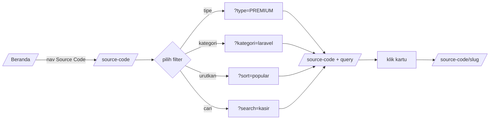
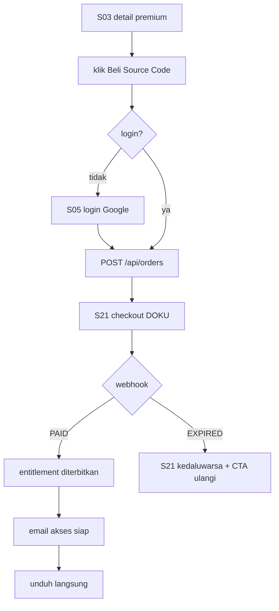

# UX Flows & Layar

Rujukan visual: [`design.md`](design.md) (tema Celestial: warna, tipografi, radius, spasi) dan dokumen `user-flows` investigasi (di luar paket ini) untuk perilaku yang teramati. [`10-design-tokens.md`](10-design-tokens.md) adalah terjemahan tokennya.
Semua layar memakai token tersebut — tidak ada warna, radius, atau font baru.

---

## 1. Inventaris layar

| # | Rute | Auth | Tujuan | Keadaan wajib |
| --- | --- | --- | --- | --- |
| S01 | `/` | publik | Beranda: hero, item unggulan, kategori | default, kosong (belum ada item unggulan) |
| S02 | `/source-code` | publik | Katalog + filter | default, hasil, 0 hasil, halaman terakhir, memuat (skeleton) |
| S03 | `/source-code/[slug]` | publik | Detail item | gratis, premium, arsip (410), tidak ada (404) |
| S04 | `/download/[slug]/ads` | publik | Interstisial iklan + countdown | hitung mundur, siap, gagal gate |
| S05 | `/login` | publik | Masuk | kredensial, hanya-Google, error, MFA |
| S06 | `/register` | publik | Daftar | satu CTA Google |
| S07 | `/tutorial` | publik | Indeks artikel | default, 0 artikel |
| S08 | `/tutorial/[slug]` | publik | Artikel | default |
| S09 | `/donasi` | publik | Sponsor | nominal awal, nominal diubah, sukses bayar |
| S10 | `/request-aplikasi` | publik | Form usulan | default, validasi gagal, terkirim |
| S11 | `/jasa-pembuatan-website` | publik | Pemasaran jasa | default |
| S12 | `/kontak` | publik | Kanal kontak | default |
| S13 | `/kebijakan-privasi` | publik | Kebijakan | default |
| S14 | `/syarat-ketentuan` | publik | S&K | default |
| S15 | `/dashboard` | USER | Ringkasan | berisi data, kosong |
| S16 | `/dashboard/source-code` | USER | Item dimiliki | daftar, kosong |
| S17 | `/dashboard/pembelian` | USER | Riwayat pembelian | daftar, kosong |
| S18 | `/dashboard/pembelian/[orderNo]` | USER | Detail invoice | berhasil, tertunda |
| S19 | `/dashboard/unduhan` | USER | Riwayat unduhan (baru) | daftar, kosong |
| S20 | `/dashboard/profile` | USER | Profil | OAuth, kredensial lokal |
| S21 | `/checkout/[orderNo]` | publik + token | Halaman pembayaran | menunggu, berhasil, kedaluwarsa |
| S22 | `/admin` | ADMIN+ | Ringkasan operasional | default, kosong |
| S23 | `/admin/item` + editor | ADMIN+ | CRUD item | draft, review, terbit, arsip, validasi gagal |
| S24 | `/admin/ulasan` | ADMIN+ | Antrean approval | kosong, ada item, diff |
| S25 | `/admin/pesanan` + detail | ADMIN+ | Operasi pesanan | default, refund |
| S26 | `/admin/pengguna` | ADMIN+ | Pengguna & peran | default, undangan |
| S27 | `/admin/pengaturan` | SUPERADMIN | Konfigurasi situs | per tab |
| S28 | `/admin/audit` | ADMIN+ | Log audit | default, ekspor |
| S29 | `/403` | — | Izin kurang | default |

---

## 2. Alur utama

### F1 — Menjelajah katalog (pengunjung)



Aturan:
- Setiap perubahan filter = navigasi, bukan fetch. Tidak ada spinner penuh; hanya indikator halus pada toolbar.
- Fokus tetap pada kontrol yang diubah setelah render (tidak melompat ke atas).
- `page` di luar rentang → dialihkan ke halaman terakhir, dengan pesan toast "Halaman 99 tidak ada, menampilkan halaman terakhir."

### F2 — Unduhan gratis (baru: interstisial sendiri)

| Langkah | Layar | Yang terjadi | Bukti/guard |
| --- | --- | --- | --- |
| 1 | S03 | Klik `Download Gratis (lewat iklan)` | Link ke `/api/download/[slug]` |
| 2 | redirect | Server `302` → `/download/[slug]/ads` | Tidak ada domain luar |
| 3 | S04 | Server set cookie `dl_gate` (15 menit); hitung mundur 10 detik; satu slot iklan | `Setting.ads.interstitialSeconds` |
| 4 | S04 | Tombol `Lanjut unduh` aktif setelah hitung mundur | Tanpa JS: tombol tetap aktif setelah reload (waktu dihitung server) |
| 5 | — | `POST /api/download/[slug]/token` | Tanpa `dl_gate` → 403 |
| 6 | — | `GET /api/download/file/[token]` mengalirkan berkas | Tanpa tautan Drive |
| 7 | S19 | Tercatat di riwayat unduhan (bila login) | ADR-008 |

Kegagalan: token kedaluwarsa → halaman `410` dengan tombol `Minta tautan baru` (kembali ke S04, bukan ke awal).

### F3 — Pembelian premium



Aturan:
- Harga di layar checkout selalu berasal dari server; klien tidak pernah mengirim nominal.
- Biaya layanan ditampilkan terpisah, bukan disisipkan diam-diam.
- Setelah pembayaran, pengguna mendarat di S18 (detail invoice), bukan halaman kosong.
- Bila webhook tertunda, S21 menampilkan "Menunggu konfirmasi" + tombol `Cek status` (maks 3×/jam).

### F4 — Unduh ulang (pemilik)

S16 atau S19 → `Unduh` → `POST /api/download/[slug]/token` dengan `purpose=PREMIUM` → aliran berkas. Tanpa pembayaran ulang, tanpa iklan.

### F5 — Registrasi & masuk

- S06 hanya punya satu tombol: `Daftar dengan Google`.
- S05: primer Google, sekunder kredensial (kolom `Tampilkan password`).
- Setelah OAuth: kembali ke `redirect` tervalidasi, default `/dashboard`.
- Akun suspended → halaman pesan khusus, bukan error generik.

### F6 — Profil

| Bagian | Akun Google | Akun lokal |
| --- | --- | --- |
| Email | `disabled` + catatan "dikelola Google" | `disabled` |
| Nama | dapat diubah | dapat diubah |
| Ganti password | paragraf penjelasan | form lama/baru/konfirmasi |
| MFA | tersedia (opsional untuk USER) | tersedia |

Simpan nama → toast + sapaan dashboard berubah tanpa reload penuh.

### F7 — Logout

Klik `Keluar` → dialog konfirmasi ("Keluar dari akun ini?") → `POST` logout → sesi dihapus dari DB → `/` dengan toast. Batal → dialog tertutup, fokus kembali ke tombol.

### F8 — Request aplikasi

S10 → isi 4 field → submit → halaman sukses berisi tautan status (`/request/[token]`) + email konfirmasi. Status berubah oleh admin → email otomatis per transisi.

### F9 — Sponsor

S09 → isi link + nominal + kategori → `Jadi Sponsor · Rp X` → checkout DOKU → setelah PAID masuk `PENDING_REVIEW` → moderasi → `ACTIVE` tayang di papan sesuai urutan nominal.

### F10 — Admin menerbitkan item

```mermaid
flowchart LR
  A[/admin/item/new] --> B[isi tab Dasar + Konten]
  B --> C[unggah thumbnail + screenshot]
  C --> D[isi driveFileId → Uji berkas]
  D --> E{harga valid?}
  E -->|PREMIUM| F[isi priceIdr]
  E -->|FREE| G[noAdsPriceIdr otomatis]
  F & G --> H[Simpan draft]
  H --> I[Terbitkan]
  I --> J{gate lolos?}
  J -->|tidak| K[tampilkan alasan per butir]
  J -->|ya| L[terbit + ISR revalidate + sitemap]
```

Aturan UI:
- Field harga **read-only** untuk ADMIN; hanya SUPERADMIN yang melihat input aktif.
- Tombol `Terbitkan` menampilkan daftar gate yang belum terpenuhi, dengan tautan langsung ke tab terkait.
- Setiap simpan menampilkan "Tersimpan · 14:32" agar admin tahu status.

### F11 — Admin refund

S25 → detail order → `Refund` → dialog: alasan (wajib, ≥ 10 karakter) + ketik `REFUND` → step-up TOTP bila sesi > 15 menit → konfirmasi → status `REFUNDED`, entitlement dicabut, token mati, audit tercatat.

### F12 — Admin mengundang admin

S26 → `Undang admin` → email + pilih bundel kapabilitas → undangan 72 jam → penerima login Google → wajib enrol MFA → aktif.

---

## 3. Aturan responsif

| Breakpoint | Perilaku |
| --- | --- |
| `< 768 px` | Satu kolom; header = logo + `Buka menu`; drawer berisi nav, pencarian, tautan akun; grid kartu 1 kolom; sidebar download menjadi blok di bawah CTA |
| `768–1023 px` | Grid 2 kolom; header masih ringkas |
| `≥ 1024 px` (`lg`) | Nav penuh + searchbox header; grid 3 kolom; detail dua kolom (konten + sidebar sticky) |
| `≥ 1280 px` | Grid 4 kolom; lebar konten maksimum 1280 px |

Drawer mobile: fokus terperangkap, `Escape` menutup, `aria-expanded` sinkron, dan `Layanan` menjadi accordion (bukan dropdown).

---

## 4. Aksesibilitas (wajib, bukan opsional)

| ID | Aturan |
| --- | --- |
| A11Y-01 | Satu `h1` per halaman; hierarki heading tanpa lompatan |
| A11Y-02 | Semua kontrol punya nama aksesibilitas unik; dua searchbox diberi label berbeda |
| A11Y-03 | Dropdown `Layanan` dapat dibuka dengan **klik dan hover**, ditutup `Escape`, fokus terkelola, `aria-expanded` akurat |
| A11Y-04 | Paginasi memakai `aria-current="page"` |
| A11Y-05 | Hitung mundur diumumkan sekali (`aria-live="polite"`), bukan tiap detik |
| A11Y-06 | Kontras teks ≥ 4,5:1 (≥ 3:1 untuk ≥24px atau ≥18,66px bold). Label di atas aqua selalu hitam (11,8:1); putih di atas aqua dilarang (1,79:1); label destruktif hitam (5,10:1). Fokus = outline `--foreground` 2px, bukan aqua saja. Aturan lengkap: `10-design-tokens.md` §8–§9 |
| A11Y-07 | Fokus terlihat (`--ring`), tidak pernah `outline: none` tanpa pengganti |
| A11Y-08 | Dialog konfirmasi memindahkan fokus ke tombol batal, `Escape` menutup |
| A11Y-09 | Gambar punya `alt` deskriptif; gambar dekoratif `alt=""` |
| A11Y-10 | Tabel admin memakai `<th scope="col">` dan dapat dinavigasi keyboard |

---

## 5. Nada dan mikroSalin (copy)

| Konteks | Gaya | Contoh |
| --- | --- | --- |
| Sukses | Ringkas, tanpa seru berlebihan | "Tersimpan." · "Tautan unduhan siap." |
| Gagal | Jelaskan sebab + langkah berikut | "Batas unduhan 5 kali per hari tercapai. Coba lagi dalam 1 jam." |
| Kosong | Sebut keadaan, lalu tawarkan jalan keluar | "Belum ada pembelian. Pembelian yang berhasil dibayar akan tercatat di sini." |
| Konfirmasi destruktif | Sebut akibat, bukan hanya pertanyaan | "Menghapus item ini juga menghapus riwayat revisinya. Ketik slug untuk melanjutkan." |
| Iklan | Jujur, tanpa menyamar | "Iklan membantu source code ini tetap gratis." |

Larangan: "Oops", "Ups", "terjadi kesalahan yang tidak diketahui" tanpa `requestId`.

---

## 6. Keadaan khusus

| Keadaan | Perilaku |
| --- | --- |
| Offline | Banner tipis "Kamu sedang offline"; aksi tulis dinonaktifkan |
| Sesi kedaluwarsa saat mengisi form | Simpan isi form di memori, minta login, pulihkan setelah login |
| Konflik versi admin | Dialog diff + pilihan `Muat ulang` atau `Timpa` (hanya SUPERADMIN) |
| Gambar gagal dimuat | Placeholder rasio tetap (mencegah CLS) + `alt` tetap terbaca |
| Berkas > 50 MB | Peringatan "Unduhan tidak dapat dilanjutkan bila terputus" sebelum mulai |
| Item diarsipkan saat dibuka | Halaman 410 + tautan katalog |
| Pembayaran sukses tapi webhook lambat | "Menunggu konfirmasi pembayaran" + polling 5 detik (maks 2 menit) lalu CTA bantuan WhatsApp |
