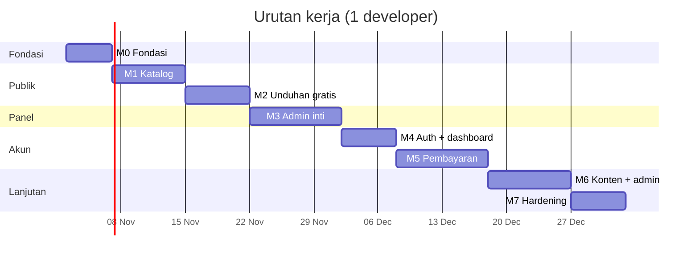
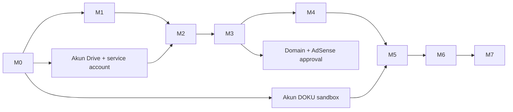

# Milestones & Rencana Kerja

Asumsi tim: **1 developer full-stack senior** (jalur utama) dengan opsi 1 desainer paruh waktu. Estimasi dalam *person-day* (pd), bukan hari kalender.

---

## 1. Peta milestone

| Milestone | Nama | Requirement | Rilis | Est. |
| --- | --- | --- | --- | --- |
| **M0** | Fondasi | — | internal | 5 pd |
| **M1** | Katalog publik | E1, E2 | v0.9 | 8 pd |
| **M2** | Unduhan gratis | E3, E12-sebagian | v0.9 | 7 pd |
| **M3** | Admin inti + tutorial | E10-inti, E7, E11 | v0.9 | 10 pd |
| **M4** | Akun & dashboard | E5, E6 | v1.0 | 6 pd |
| **M5** | Pembayaran | E4 | v1.0 | 10 pd |
| **M6** | Konten lain + admin lengkap | E8, E9, E10-lengkap | v1.1 | 9 pd |
| **M7** | Hardening & peluncuran | E11, E12 | v1.2 | 6 pd |
| | **Total** | | | **61 pd** |

Dengan 1 developer: **±12,5 minggu** (buffer 15%). Dengan 2 developer (FE/BE terpisah): **±7 minggu**, karena M1/M2 paralel dengan M3/M4 setelah M0.

---

## 2. Rincian per milestone

### M0 — Fondasi (5 pd)

| Keluaran | Kriteria selesai |
| --- | --- |
| Repo + struktur App Router + TypeScript strict | `npm run build` hijau, `tsc --noEmit` bersih |
| Tailwind + token tema Celestial dari `design.md` | Semua token `10-design-tokens.md` §2 terpasang (light + `.dark`); `theme-color` `#58d3db` |
| **shadcn/ui init + 45 primitif** | `components.json` sesuai `10-design-tokens.md`; token terpetakan; `button`, `dialog`, `form`, `table`, `sidebar` terpasang |
| **Kerangka rute** | Route group `(public)`, `(auth)`, `(app)`, `(admin)` sesuai `12-route-map.md`; 403/404/410/500 ada |
| Font: Open Sans (400/500/600) + Georgia/Menlo | Open Sans di-self-host saat build; tidak ada request runtime ke Google Fonts |
| Shell layout: header, footer, skip link | Struktur sama dengan acuan; visual mengikuti tema Celestial |
| Prisma schema + migrasi awal + seed | `prisma migrate deploy` jalan di DB kosong; terverifikasi di PostgreSQL 16.12 (`prisma/checks/invariants.sql`) |
| Docker Compose lokal (app, postgres, redis) | `docker compose up` → situs hidup |
| CI: lint, typecheck, test, build | Gagal CI memblokir merge |
| Middleware keamanan (CSP ketat, HSTS, noindex) — nonce dibatalkan, lihat ADR-007 | Header terverifikasi lewat test integrasi |

**Gate:** situs kosong bisa dibuka di staging dengan header keamanan lengkap.

### M1 — Katalog publik (8 pd)

| Keluaran | Kriteria selesai |
| --- | --- |
| S01 beranda, S02 katalog, S03 detail | Semua keadaan di `05-ux-flows.md` §1 ada |
| Filter `search`/`type`/`kategori`/`sort`/`page` di server | Semua kombinasi punya test; state pulih setelah reload |
| Paginasi + `aria-current` + redirect `308` di luar rentang | AC FR-CAT-07/08/09 lulus |
| Empty state 0 hasil | Teks dan tombol sesuai paritas |
| Galeri, metadata `<dl>`, fitur, instalasi | Struktur semantik terverifikasi |
| SEO: meta, canonical ternormalisasi, OG image | Rich Results Test lolos untuk 3 contoh |
| Skeleton loading, error boundary | Tidak ada layout shift > 0,1 |

**Gate:** katalog 69 item (data seed) dapat dijelajahi tanpa JS.

**Hasil M1 (terverifikasi di `next start` + PostgreSQL 16.12):**

- Beranda (S01) merender hero, item unggulan (cached 60 s), dan 10 chip kategori; keadaan "belum ada item unggulan" tersedia.
- Katalog lengkap tanpa JS: form GET + tombol `Terapkan filter`; `?page=99|abc|0|2` → `308`; `?type=PREMIUM&sort=newest` → `308 /source-code?type=PREMIUM`; `?sort=popular` → `200`.
- `search=kasir|kasirr|undngan|gudang` menemukan item yang benar; `zzz` → 0 hasil + "Hapus pencarian" tanpa paginator.
- Item arsip → `410` dengan isi halaman 410 dan `noindex`; slug tidak ada → `404`; URL di bilah alamat tidak berubah.
- JSON-LD `Product` + `BreadcrumbList` lolos parse, OG item `1200×630` PNG (~27 KB), canonical ternormalisasi pada 3 kombinasi filter.
- Sitemap memuat 3 item + 2 tutorial, tanpa item arsip.
- Seed: 6 media, 6 screenshot, 3 thumbnail; invariant INV-01..07 tetap lulus.

Penyimpangan sadar: (1) `410` dikirim lewat replay `fetch` karena `rewrite(..., { status: 410 })` ditimpa cache statis (`12-route-map.md` §9); (2) `FilterBar` memakai `<select>` asli, bukan popover + command, agar urutan tetap dapat diubah tanpa JS; (3) media demo berupa SVG di `public/seed` sampai R2/Drive tersedia; (4) validasi `page` dan status item berada di proxy, bukan di halaman.

### M2 — Unduhan gratis (7 pd)

| Keluaran | Kriteria selesai |
| --- | --- |
| `StorageProvider` + `GoogleDriveStorageProvider` | Baca berkas uji dari Drive lewat service account |
| Interstisial S04 + cookie `dl_gate` | Tanpa domain pihak ketiga; tanpa pop-under |
| `POST .../token` + `GET .../file/[token]` | Token sekali pakai, 5 menit, terikat sesi |
| Rate limit 5/item/24 jam | 429 dengan `Retry-After` |
| Tabel `Download` mencatat semua hasil | Uji 4 hasil: GRANTED, DENIED_RATE_LIMIT, DENIED_EXPIRED_TOKEN, ERROR |
| Peringatan berkas besar | Tampil untuk > 50 MB |

**Gate:** satu unduhan nyata selesai dari item gratis, tercatat di DB, tanpa tautan Drive pernah muncul di browser.

**Hasil M2 (terverifikasi di `next start` + PostgreSQL 16.12, `STORAGE_DRIVER=local`):**

- `GET /api/download/pos-kasir-laravel` → `302 /download/pos-kasir-laravel/ads`; `meta` → `{"sizeBytes":612,"resumable":false,"warnLargeFile":false}`.
- Halaman S04: `200`, `noindex, nofollow`, `private, no-store`, `Set-Cookie: dl_gate=…; Max-Age=900; HttpOnly; Secure; SameSite=Lax`. Hitung mundur memakai sisa waktu dari cookie: reload setelah 3 detik menampilkan "Tombol unduh aktif dalam 1 detik", reload berikutnya "Hitung mundur selesai" — waktu tidak diulang.
- Tanpa cookie: `POST .../token` (form) → `303 …?error=ad_gate_required`; (JSON) → `403 AD_GATE_REQUIRED`. Dengan cookie: `201` + `url`, `expiresAt`, `filename`, `sizeBytes`, sekaligus `Set-Cookie: dl_session`.
- Berkas: `200`, `612` byte, SHA-256 identik dengan `.storage/seed/pos-kasir-laravel.zip`, `Content-Disposition: attachment; filename="pos-kasir-laravel.zip"`, `Accept-Ranges: none`, `X-Download-Purpose: FREE_AD`. Tidak ada URL penyimpanan di HTML/JS.
- Token dipakai ulang → `410` dengan halaman "Tautan unduhan sudah kedaluwarsa" + tombol "Minta tautan baru"; token tak dikenal → `404`; item `ARCHIVED` → `410` pada ads/expired/api/token; item premium → `303 /source-code/<slug>?beli=1`.
- Kuota: 5 unduhan `GRANTED` per sesi/item/24 jam, unduhan ke-6 → `429 RATE_LIMITED` + `Retry-After`; `downloads` berisi `GRANTED`, `DENIED_RATE_LIMIT`, `DENIED_EXPIRED_TOKEN`.
- Form tanpa JavaScript: `303` langsung ke `/api/download/file/<token>` lalu berkas `200`; halaman error `?error=rate_limited&wait=3600` menampilkan "Coba lagi dalam 1 jam".
- `driveFileSize` sementara dinaikkan ke 60 MB → `warnLargeFile: true` dan `FileSizeNotice` menampilkan "Berkas besar (60 MB) — unduhan tidak dapat dilanjutkan"; nilai dikembalikan setelah uji.
- `ads.enabled=false` → halaman S04 tanpa hitung mundur (tombol langsung "Unduh sekarang") dan `POST .../token` tidak menuntut `dl_gate`; form langsung `303` ke berkas `200`. Diuji dengan baris `settings` sementara yang kemudian dihapus.

Penyimpangan sadar M2:

1. **Klaim token sebelum stream** (`UPDATE … WHERE uses < 1`), bukan menaikkan `uses` setelah selesai. Menutup balapan dua permintaan paralel; konsekuensinya tautan tidak bisa dilanjutkan setelah koneksi putus (`04-api-spec.md` §3.3).
2. **Path `/api/download/file/*` dikecualikan dari pengalihan huruf kecil.** Token base64url peka huruf besar-kecil; pengalihan `308` membuat tautan yang baru terbit langsung `404` (terbukti saat uji, lalu diperbaiki).
3. **`dl_session` dibuat sebelum token diterbitkan**, agar unduhan pertama ikut terhitung kuota. Membuatnya setelah token membuat `downloadTokens.downloadSessionId = null` pada unduhan pertama.
4. **Redis opsional.** Tanpa `REDIS_URL`, rate limit burst memakai memori per proses dan health melaporkan `not_configured`; kuota 24 jam selalu dari PostgreSQL.
5. **Driver `local` lebih dulu** karena kredensial Drive belum ada. Antarmuka `StorageProvider` sama; `driveFileId` diperlakukan sebagai kunci penyimpanan provider-agnostik. Berkas contoh dibuat seed tanpa dependensi ZIP tambahan.
6. **Halaman kedaluwarsa khusus** `/download/[slug]/expired` (bukan `/410` generik), karena pesan "Minta tautan baru" harus kembali ke S04 item yang sama.
7. **Slot iklan masih placeholder jujur** ("Slot iklan ini tersedia…") sampai data sponsor masuk (M6); tidak ada iklan palsu.
8. Hitung mundur adalah kontrol UX: server memverifikasi **umur cookie bertanda tangan**, bukan detik yang sudah berlalu (`04-api-spec.md` §3.2 mencatat alasan dan batasnya).
9. `Content-Length` diambil dari objek provider (fallback `items.driveFileSize`), dan nama berkas dirakit dari slug + ekstensi kunci, bukan nama berkas Drive.

### M3 — Admin inti + tutorial (10 pd)

| Keluaran | Kriteria selesai |
| --- | --- |
| Login admin + MFA enrol/verify | Tanpa MFA tidak bisa masuk `/admin/*` |
| `can(actor, capability)` + `requirePermission` | Matriks `09-superadmin-admin.md` §2.3 lulus uji per peran |
| CRUD item lengkap + gate publikasi | AC-ADM-01/02/07 lulus |
| Pustaka media (R2, alt wajib, dedup) | AC-ADM-08 lulus |
| `AdminAuditLog` + `Revision` | AC-ADM-04 lulus; tabel menolak UPDATE/DELETE |
| CRUD tutorial + pratinjau | Artikel baru tayang di `/tutorial` |
| Halaman `/admin/ulasan` (antrean approval) | AC-ADM-03 lulus |

**Gate:** pemilik membuat, menerbitkan, dan mengarsipkan item **tanpa menyentuh database**.

**Hasil M3 fase 1 — autentikasi, MFA, RBAC, gerbang panel (terverifikasi di `next start` + PostgreSQL 16.12):**

Commit `ae186a2`. Yang selesai dan diuji:

- **Login kredensial**: `admin@reditech.id` / `Reditech#2026` (dev) → `/admin/mfa`; kata sandi salah → pesan generik tanpa membocorkan keberadaan akun; audit `auth.login`/`auth.mfa.challenge` tercatat.
- **MFA TOTP**: enrol menampilkan QR (data URL, tanpa domain pihak ketiga) + kunci manual; konfirmasi menghasilkan **10 kode pemulihan** yang ditampilkan sekali; kode pemulihan yang dipakai langsung hangus di DB; menonaktifkan MFA butuh kode TOTP.
- **Gerbang proxy** (curl, `next start` :3100):
  - anonim `/admin` → `307 /login?redirect=%2Fadmin`; anonim `/admin/mfa` → `307` dengan `redirect=%2Fadmin%2Fmfa`.
  - cookie sesi sampah → `307 /login` **dan** `rd_session` dihapus.
  - `USER` `/admin` dan `/admin/item` → **403** + `x-robots-tag: noindex, nofollow`, tanpa satu pun teks panel di body.
  - SUPERADMIN tanpa MFA `/admin` dan `/admin/item` → `307 /admin/mfa`; `/admin/mfa` sendiri `200`.
  - editor (bundel `BUNDLES.editor`, MFA aktif): `/admin` `200`, `/admin/item` `200`, `/admin/pengguna` **403**, `/admin/ulasan` **403**.
  - anonim `/login/mfa` → `307 /login` (tanpa cookie tantangan).
- **Browser (Playwright + Chrome terpasang)**: alur penuh lulus tanpa error konsol — anonim → login → enrol QR → 10 kode pemulihan → panel → dialog keluar → halaman masuk → verifikasi TOTP → `/admin/item` → editor 403 → USER 403.
- **Logout** menghapus baris `sessions` (jumlah sesi admin kembali 1 setelah keluar, dari 2).
- `tsc --noEmit`, `eslint`, dan `next build` bersih; `dev-scripts/` (harness sementara) dan `playwright` tidak di-commit.

Penyimpangan sadar M3 (fase 1):

1. **Lapisan sesi sendiri, bukan Auth.js.** Auth.js Credentials provider tidak mendukung database session, sedangkan FR-AUTH-03/06 menuntut sesi yang bisa dicabut dan rotasi. Implementasi memakai tabel `sessions` yang kompatibel dengan skema Auth.js: `sessionToken` berisi **sha256** dari token acak 32 byte, cookie `rd_session` `HttpOnly`, `SameSite=Lax`, `Secure` di produksi. M4 dapat memakai Auth.js untuk Google OAuth dan berbagi tabel yang sama.
2. **Kata sandi memakai `scrypt` bawaan Node** (`scrypt$N$r$p$salt$hash`), bukan bcrypt/argon2, agar tidak menambah dependensi native di Docker.
3. **TOTP ditulis sendiri** (RFC 6238) + `qrcode` untuk QR; tidak memakai paket OTP yang menarik dependensi besar.
4. **Tidak ada route handler `/api/auth/mfa/*`.** Enrol/verifikasi/nonaktif dijalankan sebagai Server Action; klien non-browser belum dilayani (dicatat di `12-route-map.md` §6).
5. **Guard tiga lapis, layout bukan batas.** Terbukti di runtime: saat layout melempar `forbidden()`, HTML halaman tetap ikut terkirim. Karena itu status final ditentukan proxy (replay `/403`), dan setiap halaman serta Server Action memanggil guard sendiri.
6. **`SEED_ADMIN_PASSWORD` kosong ≠ kata sandi kosong.** Nilai kosong diperlakukan sebagai "tidak diisi" supaya `.env` hasil salinan `.env.example` tidak mematikan akun uji; di produksi seed tidak memasang kata sandi sama sekali (pemilik masuk lewat Google OAuth/undangan di M4).
7. **Seed membuat dua akun uji non-produksi** (`editor@reditech.id` bundel Editor, `pengguna@reditech.id` USER) agar matriks izin dan AC-ADM-10 bisa diuji tanpa OAuth.
8. **CSP `upgrade-insecure-requests` hanya untuk permintaan https.** Tanpa syarat itu, prefetch RSC lokal gagal (`ERR_SSL_PROTOCOL_ERROR`) dan dua shell tampil bersamaan (`12-route-map.md` §12.1).
9. **Enrol MFA tidak memanggil `revalidatePath`.** Kode pemulihan hanya ada di state aksi; render ulang melepas form sebelum kode dibaca. Tombol "Lanjut ke panel" sengaja `<a>` (muat ulang penuh) agar prefetch `/admin` yang ter-cache sebagai `307` sebelum MFA aktif tidak dipakai lagi.
10. **`/login/mfa` memanggil `await connection()`** sebelum membaca cookie: `readMfaChallenge()` memakai `Date.now()`, yang dilarang saat prerender.

Masih terbuka di M3 (fase 2): CRUD item + gate publikasi, pustaka media, CRUD tutorial + halaman `/tutorial` publik, `/admin/ulasan`, pengaturan (termasuk aset brand/landing sebagai baris `Media`), audit + ekspor CSV, dan isi dashboard `/admin`. Sampai itu selesai, halaman-halaman tersebut masih berupa `RouteStub` yang sudah dijaga kapabilitas.

**Hasil M3 fase 2a — taksonomi (kategori & teknologi), terverifikasi di `next start` + PostgreSQL 16.12 + browser:**

- `/admin/kategori` dan `/admin/teknologi` bukan lagi `RouteStub`. Keduanya menampilkan form tambah (nama, slug opsional yang dibuat otomatis dari nama, urutan + status aktif untuk kategori), daftar baris yang bisa disunting langsung, dan tombol hapus berkonfirmasi.
- Server Action (`src/app/(admin)/admin/kategori/actions.ts`, `teknologi/actions.ts`) memanggil `actionActor("taxonomy:write")`; hapus memakai `can(actor, "taxonomy:delete")`. Logikanya di `src/lib/admin/taxonomy.ts` dan setiap mutasi menulis satu baris audit (`category.create/update/delete`, `technology.create/update/delete`).
- Guard hapus diuji dua arah: tombol mati bila entitas dipakai, **dan** server tetap menolak saat baris sudah basi (kategori dipakai 1 item setelah halaman dirender → aksi mengembalikan pesan "masih dipakai 1 item", bukan menghapus).
- Katalog ikut segar: `updateTag("categories")` + `updateTag("items")` (bukan `revalidateTag`, yang di Next 16.4.3 butuh argumen profil) supaya chip filter dan halaman item langsung mencerminkan perubahan.
- Kapabilitas diuji dengan akun editor (`taxonomy:read` + `taxonomy:write`, tanpa `taxonomy:delete`): form tambah tampil, semua tombol hapus mati, dan penambahan berhasil.
- Status HTTP: anonim `/admin/kategori` → `307 /login?redirect=%2Fadmin%2Fkategori`; `USER` → `403`; editor dan superadmin → `200`.

Penyimpangan kecil M3 fase 2a: (1) hapus memakai `onClick` + `startTransition`, bukan `<form>` di dalam dialog — `AlertDialogContent` melepas isinya saat ditutup sehingga state aksi hilang sebelum toast tampil (dialog memang butuh JS); (2) checkbox "Aktif" memakai `<input type="checkbox">` asli agar tetap terkirim tanpa JS, sama seperti pola `<select>` di `FilterBar`; (3) nav `/admin/entitlement` disamakan dengan peta rute (`entitlement:grant`); (4) `ActionForm` menerima `fieldLabels` agar kesalahan validasi tampil sebagai "Slug", bukan `slug`.

### M4 - Akun & dashboard (6 pd)

| Keluaran | Kriteria selesai |
| --- | --- |
| Google OAuth + kredensial lama | Dua jalur masuk berfungsi; register hanya Google |
| Sesi DB + cookie aman + rotasi | Tidak ada token di Web Storage |
| Dashboard: ringkasan, source code saya, riwayat pembelian, **riwayat unduhan** | Empty state sesuai paritas |
| Profil: nama, email disabled, password kondisional | AC FR-AUTH-04/05 |
| Logout dengan konfirmasi | Sesi terhapus dari DB |
| Suspensi akun | Login ditolak, sesi lama mati |

**Gate:** satu pengguna uji dapat login, melihat riwayat unduhan gratisnya, dan logout.

### M5 — Pembayaran (10 pd)

| Keluaran | Kriteria selesai |
| --- | --- |
| `POST /api/orders` + invoice DOKU | Nominal server-side; snapshot harga |
| Halaman checkout S21 + status | Menunggu/berhasil/kedaluwarsa |
| Webhook + signature + idempotensi | Kiriman ganda tidak menggandakan entitlement |
| State machine order + cron kedaluwarsa + rekonsiliasi | AC FR-PAY-05/06/07 |
| `Entitlement` + unduh ulang | AC FR-DL-08, F4 |
| Invoice cetak + email akses | Email berisi tautan ke dashboard, bukan tautan Drive |
| Refund manual | AC-ADM-05 lulus |

**Gate:** **satu pembelian nyata** (nominal terendah) dari awal sampai unduhan berhasil, lalu diuji ulang dengan refund di staging.

### M6 — Konten lain + admin lengkap (9 pd)

| Keluaran | Kriteria selesai |
| --- | --- |
| Sponsor: form, papan, moderasi, urutan | FR-CMS-03/04, FR-ADM-08 |
| Request aplikasi + pipeline + email | FR-CMS-05, FR-ADM-09 |
| Admin pesanan, entitlement, pengguna, pengaturan, audit | FR-ADM-11..15 |
| Revisi + restore | AC-ADM-06, FR-ADM-16 |
| Aksi massal + ekspor CSV | FR-ADM-17, AC-ADM-10 |
| Halaman jasa/kontak/privasi/syarat final | Teks sesuai implementasi nyata |

**Gate:** tidak ada lagi operasi rutin yang memerlukan akses database.

### M7 — Hardening & peluncuran (6 pd)

| Keluaran | Kriteria selesai |
| --- | --- |
| Audit aksesibilitas (axe + keyboard) | 0 pelanggaran serius pada 6 halaman |
| Uji beban k6 | 200 rps baca, 20 order/menit, p95 < 500 ms |
| Uji restore backup | RTO < 4 jam terbukti |
| Runbook insiden + alert | 6 alert aktif (lihat `08-deployment.md`) |
| Rewrite kebijakan privasi & S&K | Cocok 1:1 dengan implementasi |
| Checklist peluncuran | Semua butir di `07-test-plan.md` §7 dicentang |

**Gate:** peluncuran dengan rollback teruji.

---

## 3. Dependensi dan jalur kritis

| Dependensi eksternal | Dibutuhkan sebelum | Pemilik |
| --- | --- | --- |
| Service account Google Drive + akses folder | M2 mulai | Pemilik |
| Akun DOKU sandbox + secret | M5 mulai | Pemilik |
| Domain + Cloudflare zone | M7 | Pemilik |
| Persetujuan AdSense | M7 (boleh setelah rilis) | Pemilik |
| Teks kebijakan yang disetujui | M7 | Pemilik |

---

## 4. Definisi selesai (DoD) — berlaku di semua milestone

1. Requirement ber-ID terimplementasi dan punya test otomatis (kecuali yang eksplisit manual).
2. `lint`, `typecheck`, `test`, `build` hijau di CI.
3. Tidak ada `TODO` tanpa tiket.
4. Halaman baru punya keadaan: memuat, kosong, error, tanpa izin.
5. Header keamanan terverifikasi pada rute baru.
6. Aksesibilitas: navigasi keyboard dan nama aksesibilitas diperiksa.
7. Perubahan skema disertai migrasi + catatan rollback.
8. Didemokan di staging oleh pembuat, bukan hanya "sudah jalan di lokal".

---

## 5. Yang boleh meleset (dan yang tidak)

| Boleh bergeser | Tidak boleh bergeser |
| --- | --- |
| Jumlah item pada seed | Gate publikasi (tidak ada konten tanpa berkas terverifikasi) |
| Animasi/transisi halus | Redirect `308` paginasi (bug yang harus hilang) |
| Isi artikel tutorial | Tidak ada tautan Drive di browser |
| Aksi massal admin | Audit log setiap aksi admin |
| JSON-LD | Idempotensi webhook |

---

## 6. Setelah v1.2 (backlog, belum dijadwalkan)

| Item | Alasan ditunda |
| --- | --- |
| Migrasi storage ke R2 | Butuh keputusan biaya; ADR-002 sudah siap |
| Invoice PDF bertanda | Nilai rendah untuk v1 |
| Multi-bahasa | Pasar tunggal |
| API publik untuk mitra | Belum ada mitra |
| Rekomendasi item serupa berbasis data | Butuh volume data |
| Aplikasi mobile | Web responsif sudah cukup |
